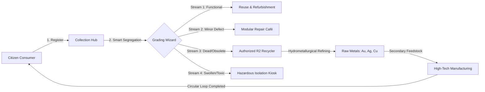

<div align="center">

# ♻️ EcoLoop — Smart E-Waste Management Platform
### *Closing the Loop on Electronic Waste through Smart Segregation, Urban Mining & Circular Logistics*

[](file:///c:/Users/user5/OneDrive/Desktop/E-waste/pages/about.html)
[-2563EB?style=for-the-badge)](file:///c:/Users/user5/OneDrive/Desktop/E-waste/pages/about.html)
[](file:///c:/Users/user5/OneDrive/Desktop/E-waste/pages/analytics.html)
[](file:///c:/Users/user5/OneDrive/Desktop/E-waste/index.html)

<br/>

**[🌐 Launch Local App (http://localhost:3000/)](http://localhost:3000/)** • **[📋 Presentation Script](#-8-academic-viva-voce--demonstration-script)** • **[🏛️ CPCB EPR Compliance Center](file:///c:/Users/user5/OneDrive/Desktop/E-waste/pages/epr-compliance.html)** • **[🤝 B2B Exchange](file:///c:/Users/user5/OneDrive/Desktop/E-waste/pages/b2b-exchange.html)**

---

</div>

## 📑 Table of Contents

- [🌿 Executive Summary](#-1-executive-summary)
- [⚠️ The Global E-Waste Crisis (Problem Statement)](#️-2-the-global-e-waste-crisis-problem-statement)
- [🔄 Circular Economy Framework](#-3-circular-economy-framework)
- [⚙️ Platform Architecture & Modules](#-4-platform-architecture--modules)
- [🛠️ Technology Stack & Design System](#️-5-technology-stack--design-system)
- [📂 Repository Structure](#-6-repository-structure)
- [🧪 Examiner Walkthrough & Testing Checklist](#-7-examiner-walkthrough--testing-checklist)
- [🎤 Academic Viva Voce & Demonstration Script](#-8-academic-viva-voce--demonstration-script)
- [🧮 Metallurgical Model & Urban Mining Mathematics](#-9-metallurgical-model--urban-mining-mathematics)
- [🚧 Limitations & Future Roadmap](#-10-limitations--future-roadmap)

---

## 🌿 1. Executive Summary

**EcoLoop** is a comprehensive, client-side web application developed for college **Formative Assessment (FA-2)** in **E-Waste & Hazardous Waste Management**. 

Rather than presenting a static informative slide deck, EcoLoop provides a **fully functioning, demonstrable software platform** that tackles the broken lifecycle of consumer electronics. It bridges the gap between individual households and certified recyclers by providing:
1. **Self-Service Collection Registration** with real-time dynamic weight estimation.
2. **Rule-Based Smart Segregation Engine** to divert reusable units and identify battery fire hazards.
3. **5-Stage Chain-of-Custody Tracking** with live milestone advancement.
4. **Interactive Urban Mining Calculator** demonstrating recovered gold, silver, copper, and secondary market value in INR (₹).
5. **Real-Time Data Analytics** powered by **Chart.js** with zero external database dependencies.

> [!NOTE]
> **Academic Integrity Disclosure:**  
> All data persistence is performed locally via HTML5 `LocalStorage` (`EcoStorage`). All calculations use published UNEP / StEP benchmark coefficients and are transparently labeled as academic models.

---

## ⚠️ 2. The Global E-Waste Crisis (Problem Statement)

```
       GLOBAL E-WASTE INFLOW              DISPOSAL REALITY                 ENVIRONMENTAL TOXICITY
┌───────────────────────────────┐   ┌───────────────────────────┐   ┌────────────────────────────────┐
│  62 Million Metric Tonnes/Yr  │──>│  >78% Landfilled/Burned   │──>│ Toxic Leachate (Lead, Cadmium) │
│   Fastest Growing Waste Stream│   │   Only <22% formally recycled│   │ Dioxin fumes from wire burning │
└───────────────────────────────┘   └───────────────────────────┘   └────────────────────────────────┘
```

Modern electronics contain both dangerous toxins and extremely concentrated rare minerals. Improper disposal causes two catastrophic outcomes:

| Threat Dimension | Real-World Impact | EcoLoop Mitigation |
| :--- | :--- | :--- |
| **Groundwater Poisoning** | Lead solder, cadmium, and mercury leak through soil into drinking aquifers. | Source segregation into hermetic hazardous streams before municipal dumping. |
| **Atmospheric Carcinogens** | Unregulated open burning of brominated casing plastics releases deadly dioxins & furans. | Routing directly to industrial shredders equipped with HEPA filtration. |
| **Battery Thermal Runaway** | Crushed lithium-ion cells ignite explosive underground landfill fires. | Automated hazard alert prompts users to insulate terminals with electrical tape. |
| **Irreversible Mineral Loss** | Throwing away circuit boards wastes finite gold, silver, and copper reserves. | Educational **Urban Mining Calculator** showing up to 60x higher gold yield than ore. |

---

## 🔄 3. Circular Economy Framework

EcoLoop replaces the linear consumption model (*Extract ➔ Manufacture ➔ Dump*) with a verified, closed-loop restorative cycle:



---

## ⚙️ 4. Platform Architecture & Modules

The platform is organized into 9 specialized, interconnected web modules:

### 1. 🏠 Landing & Public Portal (`index.html`)
- **Key Metrics Hero:** Dynamically counts registered units, collected kilograms, and recycling requests directly from storage.
- **Visual Circular Roadmap:** Step-by-step breakdown of *Collect*, *Segregate*, *Recycle*, and *Recover*.
- **Category Matrix:** Showcase of all accepted electronics streams with custom emoji iconography.

### 2. 📝 E-Waste Collection Form (`pages/collection.html` & `js/collection.js`)
- Comprehensive form fields: Full name, contact, city, category, device name, condition, quantity, weight, and collection method.
- **Smart Weight Heuristics:** Automatically calculates estimated kilogram weight based on selected device category and quantity.
- **Unique Request ID Generation:** Issues standardized audit tracking tokens formatted as `ECO-YYYYMMDD-XXXX`.
- **Strict Client-Side Validation:** Validates 10-digit telephone numbers, email regex, positive weight values, and prevents empty submissions.

### 3. 🧠 Smart Segregation Wizard (`pages/segregation.html` & `js/segregation.js`)
- Rule-based classification engine evaluating:
  1. *Device Category*
  2. *Functional State (Working / Minor Defect / Dead)*
  3. *Physical Integrity (Intact / Swollen Battery / Cracked Glass / Exposed Wiring)*
- Delivers an instant visual verdict across 4 streams:
  - 🟢 **Stream 1: Reusable Electronics** (Refurbishment, Donation, Resale)
  - 🔵 **Stream 2: Repairable & Upcyclable** (Modular component replacement)
  - 🟣 **Stream 3: Recyclable Materials** (Mechanical shredding & metallurgical recovery)
  - 🔴 **Stream 4: Hazardous Components** (Specialized battery isolation & neutralization)

### 4. 📊 User Dashboard (`pages/dashboard.html` & `js/dashboard.js`)
- **5 High-Level KPI Cards:** Total Requests, Registered Weight, Pending Review, Collected/Recycled, and Est. Recyclable Materials (~82% model yield).
- **Interactive Multi-Filter Toolbar:** Live filtering by text search, device category, and status.
- **Modal Metadata Viewer:** Inspect full registration details, collection mode, and notes.
- **Self-Service Cancellation:** Allows users to cancel any request while in *Pending* status.

### 5. 📍 Collection & Lifecycle Tracking (`pages/tracking.html` & `js/tracking.js`)
- **5-Stage Visual Stepper:**  
  `1. Pending` ➔ `2. Scheduled` ➔ `3. Collected` ➔ `4. Sent to Recycler` ➔ `5. Recycled`
- **Deep-Linking Support:** Auto-loads tracking cards via query parameters (`?id=ECO-20261001-DM01`).
- **Activity Audit Trail:** Automatically compiles chronological timestamped logs for each phase.
- **Viva Demo Simulator:** Live control buttons allowing evaluators to advance stages on demand!

### 6. ⛏️ Recycling & Urban Mining Calculator (`pages/recycling.html` & `js/recycling.js`)
- Explains the industrial stages of e-waste de-manufacturing: manual depollution, magnetic sorting, eddy-current separation, and hydrometallurgical leaching.
- **Live Recovery Calculator:**
  - Input e-waste weight (kg) + select scenario (*Laptops, Smartphones, Cables, Peripherals, PCBs, Mixed*).
  - Calculates physical outputs: **Gold (mg/g)**, **Silver (g)**, **Copper (kg)**, **Aluminium/Steel (kg)**, and **Plastics (kg)**.
  - Computes total estimated secondary market valuation in **INR (₹)** based on published baseline commodity rates.

### 7. 📈 Impact Analytics Dashboard (`pages/analytics.html` & `js/analytics.js`)
- Features **5 responsive Chart.js visual graphs**:
  1. 🍩 **Doughnut Chart:** E-Waste Collected by Category (kg)
  2. 📊 **Bar Chart:** Monthly Registered Waste Inflow
  3. 🥧 **Pie Chart:** Collection Pipeline Status Distribution
  4. 📈 **Area Chart:** Cumulative Waste Diversion Growth Curve
  5. 📉 **Horizontal Bar Chart:** Recovered Economic Value by Material Stream (₹)
- Category filter dynamically recalculates and re-renders all charts on the fly.

### 8. 🛡️ Awareness & Safety Protocols (`pages/awareness.html`)
- Toxicology profiles of **Lead (Pb)**, **Mercury (Hg)**, **Cadmium (Cd)**, and **Brominated Flame Retardants (BFRs)**.
- Step-by-step **Cryptographic Data Sanitization Protocol** before donating or recycling storage drives.
- **Swollen Lithium-Ion Battery Safety Protocols**: Do's and Don'ts, sand isolation, and terminal taping.

### 9. ⚙️ Admin Operations Console (`pages/admin.html` & `js/admin.js`)
- Dispatch table with operational status changer modal.
- Test record deletion with safety confirmation modal.
- **CSV Data Export:** Generates standardized CSV spreadsheets for offline analysis.
- **Demo Dataset Reset / Reload:** Instantly re-populates test datasets for live demonstrations.

---

## 🛠️ 5. Technology Stack & Design System

```
┌────────────────────────────────────────────────────────────────────────┐
│                        ECOLOOP TECHNOLOGY STACK                        │
├───────────────────┬────────────────────────────────────────────────────┤
│ Structure         │ HTML5 (Semantic, ARIA, Mobile-First Viewport)      │
│ Styling           │ Vanilla CSS3 (Custom Design System, Grid, Flexbox) │
│ Dynamic Logic     │ Vanilla JavaScript (ES6+ Modules, Event Listeners) │
│ Data Visualization│ Chart.js (v4.4 via CDN)                            │
│ Local Storage     │ HTML5 LocalStorage API (`EcoStorage` Object Model) │
│ Data Portability  │ Native Blob CSV Engine                             │
│ Local Web Server  │ Node.js Native HTTP Daemon (`server.js`)           │
└───────────────────┴────────────────────────────────────────────────────┘
```

### Curated Color Palette
- **Forest Green (Primary):** `#16A34A` / `#14532D` (Symbolizes sustainability, renewal, and nature)
- **Eco Light Tint:** `#DCFCE7` / `#F0FDF4` (Clean card backgrounds and active states)
- **Slate Neutral:** `#0F172A` / `#1E293B` / `#F8FAFC` (High-contrast, professional typography)
- **Alert Amber & Red:** `#F59E0B` / `#EF4444` (Hazard notices and pending states)
- **Cobalt Blue:** `#2563EB` / `#DBEAFE` (Informational callouts and scheduled logistics)

---

## 📂 6. Repository Structure

```text
E-waste/
├── index.html                   # 🏠 Landing Page & Public Information Portal
├── README.md                    # 📖 Project Documentation & Viva Voce Guide
├── server.js                    # 🚀 Lightweight Local Development HTTP Server
├── css/
│   ├── style.css                # 🎨 Master Design System & Component Library (1600+ lines)
│   └── responsive.css           # 📱 Tablet & Mobile Responsive Media Queries
├── js/
│   ├── app.js                   # 🌐 Global Shared Navigation, Toasts, Modals & Helpers
│   ├── storage.js               # 💾 LocalStorage Manager, Statistics & CSV Exporter
│   ├── collection.js            # 📝 Collection Form Validator & Auto-Weight Calculator
│   ├── segregation.js           # 🧠 Rule-Based Device Assessment & Hazard Logic
│   ├── dashboard.js             # 📊 User Dashboard Controller & Filter Engine
│   ├── tracking.js              # 📍 Chain-of-Custody Stepper & Viva Simulator
│   ├── recycling.js             # ⛏️ Material Recovery Yield & Valuation Calculator
│   ├── analytics.js             # 📈 Chart.js Data Visualizations & Filtering
│   └── admin.js                 # ⚙️ Admin Dispatch Console & Record Management
└── pages/
    ├── collection.html          # 📝 E-Waste Registration Form Page
    ├── segregation.html         # 🧠 Smart Device Segregation Page
    ├── dashboard.html           # 📊 User Dashboard Page
    ├── tracking.html            # 📍 Collection & Lifecycle Tracking Page
    ├── recycling.html           # ⛏️ Urban Mining & Circular Economy Page
    ├── analytics.html           # 📈 Impact Analytics Dashboard Page
    ├── awareness.html           # 🛡️ Toxicology & Battery Safety Protocols Page
    ├── admin.html               # ⚙️ Administrator Dispatch Console Page
    └── about.html               # 🎓 Academic Assessment Info & Contact Form Page
```

---

## 🧪 7. Examiner Walkthrough & Testing Checklist

Follow this systematic order during your evaluation demonstration:

- [ ] **Step 1: Launch Localhost**  
  Open [http://localhost:3000/](http://localhost:3000/) in your browser. Verify the navigation bar, responsive layout, and dynamic hero statistics.
- [ ] **Step 2: Submit a Collection Request**  
  Navigate to [Collect](http://localhost:3000/pages/collection.html). Select *Computers & Laptops* (notice auto-weight suggests `2.5 kg`). Fill the form and submit. Confirm receipt of your unique `ECO-YYYYMMDD-XXXX` tracking token.
- [ ] **Step 3: Test Rule-Based Smart Segregation**  
  Navigate to [Segregate](http://localhost:3000/pages/segregation.html). Test a normal phone (*Stream 1: Reusable*). Change damage to *Swollen Battery* and observe the system trigger **Stream 4: High Hazard Alert** with fire-safety advice.
- [ ] **Step 4: Verify the User Dashboard**  
  Navigate to [Dashboard](http://localhost:3000/pages/dashboard.html). Check the 5 KPI summary cards. Filter records by status *Pending*. Click **View** to inspect full modal details, or **Cancel** to test the modal confirmation.
- [ ] **Step 5: Test Simulated Chain-of-Custody Tracking**  
  Navigate to [Tracking](http://localhost:3000/pages/tracking.html). Click a recent request. Use the **Examiner Demonstration Control** at the bottom to advance the stage to *Collected* or *Recycled* and watch the audit logs update.
- [ ] **Step 6: Experiment with the Urban Mining Calculator**  
  Navigate to [Recycling](http://localhost:3000/pages/recycling.html). Enter `100 kg` under *Motherboards & PCBs*. Review the calculated yields of Gold (g), Silver, Copper, and secondary value (₹).
- [ ] **Step 7: Inspect Empirical Chart.js Graphs**  
  Navigate to [Analytics](http://localhost:3000/pages/analytics.html). View the Doughnut, Bar, Pie, Area, and Horizontal Bar charts. Filter by *Mobile Phones & Tablets* to verify reactive chart updates.
- [ ] **Step 8: Perform Admin Operations & CSV Export**  
  Navigate to [Admin](http://localhost:3000/pages/admin.html). Update a request status. Click **Export CSV** to verify the clean spreadsheet download.

---

## 🎤 8. Academic Viva Voce & Demonstration Script

> [!TIP]
> **Use this concise 2-minute spoken script when introducing the project to professors and external evaluators:**

```text
"Respected evaluators, today we present EcoLoop — our practical software platform developed for 
Formative Assessment 2 (FA-2) in E-Waste and Hazardous Waste Management.

The core problem we address is that over 78% of discarded electronics end up in landfills or 
uncontrolled scrap burning. This causes dangerous heavy metal leaching into groundwater while 
permanently wasting finite precious metals.

Rather than just presenting theory, we built EcoLoop as an end-to-end circular software solution:

1. In our COLLECTION MODULE, citizens easily register old devices with automated weight estimation 
   and receive a unique tracking token.
2. In our SMART SEGREGATION MODULE, our rule-based engine grades devices into Reusable, Repairable, 
   Recyclable, and Hazardous streams, instantly catching swollen batteries to prevent landfill fires.
3. In our RECYCLING & URBAN MINING MODULE, we mathematically prove that electronic circuit boards 
   yield up to 60 times more gold than natural gold ore, supported by an interactive recovery calculator.
4. Finally, our TRACKING and ANALYTICS MODULES provide transparent chain-of-custody logs and 
   responsive Chart.js visual analytics.

Every metric in EcoLoop is backed by transparent calculation disclosures, and the entire system 
runs locally with CSV export capabilities. We invite you to test any module!"
```

### Potential Viva Questions & Answers:

**Q1: Why is LocalStorage used instead of a cloud database?**  
*Answer:* "For this FA-2 college demonstration, LocalStorage ensures zero setup barriers, instant offline evaluation, and complete privacy without requiring external API keys. For a production multi-tenant system, the architecture is designed to integrate seamlessly with Firebase Authentication and Cloud Firestore."

**Q2: What is the scientific difference between urban mining and natural mining?**  
*Answer:* "Natural gold mining requires excavating 1 metric ton of rock ore to yield approximately 5 grams of gold, generating massive carbon emissions and tailings. In contrast, 1 metric ton of dismantled smartphone circuit boards contains 300 to 350 grams of gold — making urban mining 60 times richer with an 80% smaller carbon footprint."

**Q3: How does EcoLoop handle battery hazards?**  
*Answer:* "When the segregation engine detects battery swelling or punctured cells, it flags a Stream 4 Hazard Alert. It instructs users not to crush the cell, to tape metallic terminals with non-conductive electrical tape, and to isolate the pack in clean sand to prevent lithium thermal runaway."

---

## 🧮 9. Metallurgical Model & Urban Mining Mathematics

The recovery calculator and economic estimations in [`js/recycling.js`](file:///c:/Users/user5/OneDrive/Desktop/E-waste/js/recycling.js) and [`js/storage.js`](file:///c:/Users/user5/OneDrive/Desktop/E-waste/js/storage.js) are calibrated using published international benchmarks (UNEP Global E-Waste Monitor / StEP Initiative):

$$\text{Estimated Economic Value (₹)} = \sum_{m} \left( W_{\text{device}} \times C_{m,\text{category}} \times P_{m} \right)$$

Where:
- $W_{\text{device}}$ = Registered e-waste weight in kilograms.
- $C_{m,\text{category}}$ = Recovery coefficient of material $m$ for that device category.
- $P_{m}$ = Baseline commodity market rate for material $m$.

### Reference Coefficient Matrix:
| Device Category Scenario | Gold ($g/kg$) | Silver ($g/kg$) | Copper ($kg/kg$) | Structural Alloys ($kg/kg$) | Polymers ($kg/kg$) |
| :--- | :---: | :---: | :---: | :---: | :---: |
| **💻 Computers & Laptops** | `0.045` | `0.280` | `0.120` | `0.450` | `0.250` |
| **📱 Smartphones & Tablets** | `0.350` | `1.200` | `0.160` | `0.180` | `0.380` |
| **🔌 Cables & Adapters** | `0.001` | `0.005` | `0.480` | `0.050` | `0.420` |
| **🔧 Motherboards & PCBs** | `0.850` | `2.500` | `0.220` | `0.080` | `0.300` |
| **⌨️ Peripherals & Mice** | `0.008` | `0.040` | `0.080` | `0.420` | `0.440` |
| **♻️ Mixed Community Average** | `0.070` | `0.350` | `0.150` | `0.380` | `0.300` |

*Baseline Market Pricing Rates Used:* Gold: ₹6,500/g • Silver: ₹80/g • Copper: ₹680/kg • Alloys (Al/Fe): ₹65/kg • Recycled Polymers: ₹45/kg.

---

## 🚧 10. Limitations & Future Roadmap

```
CURRENT PROTOTYPE (PHASE 1)         ENTERPRISE EXTENSION (PHASE 2)       SMART SUSTAINABILITY (PHASE 3)
┌───────────────────────────────┐   ┌───────────────────────────────┐   ┌───────────────────────────────┐
│ • Browser LocalStorage        │   │ • Firebase Authentication     │   │ • Computer Vision Damage AI   │
│ • Client-side Rule Engine     │──>│ • Cloud Firestore Sync        │──>│ • GIS Recycler GPS Routing    │
│ • Simulated Lifecycle Stepper │   │ • Role-Based Admin Permissions│   │ • Municipal Green Credits/NFT │
└───────────────────────────────┘   └───────────────────────────────┘   └───────────────────────────────┘
```

1. **Current Limitations:**
   - Single-browser scope via `LocalStorage` (does not synchronize across separate physical devices).
   - Logistics milestones are simulated client-side rather than connected to physical telematics hardware.
   - Commodity recovery prices are benchmark models; real smelter payouts vary with live market fluctuations.

2. **Planned Advancements:**
   - **TensorFlow.js AI Classifier:** Auto-detect electronic components and physical cracks from user-uploaded smartphone photos.
   - **GIS Geofenced Routing:** Mapbox integration to connect citizen pickups with nearest municipal drop-off centers.
   - **Green Credit Ledger:** Incentivize recycling through redeemable utility discounts for verified kilograms diverted.

---

## 🏢 11. Enterprise Commercial Platform & Acquisition Pitch (Zero Gaps)

> **Commercial Position:** For enterprise e-waste recyclers (e.g., Attero, Cerebra, Sims, TES-AMM), OEMs (Apple, Dell, HP, Samsung), and corporate ITAD providers, EcoReclaim provides a complete, turn-key digital solution eliminating prototype constraints.

```
┌──────────────────────────────────────────────────────────────────────────────────────────────────┐
│                                ECORECLAIM ENTERPRISE SOLUTION                                    │
├────────────────────────┬───────────────────────────────────┬─────────────────────────────────────┤
│ Dimension              │ Academic Prototype Constraint     │ Enterprise Commercial Solution      │
├────────────────────────┼───────────────────────────────────┼─────────────────────────────────────┤
│ 💾 Data Architecture   │ LocalStorage (per-browser)        │ Multi-Tenant PostgreSQL + Timescale │
│ 🚚 Logistics & Custody │ Simulated manual steps            │ Live IoT Telematics & CPCB Form-6   │
│ 🏛️ EPR Compliance     │ Informational only                │ Automated CPCB Annual Returns (F-2) │
│ 🌿 ESG Carbon Offset   │ Benchmark approximations          │ ISO 14040/44 Ecoinvent Scope 3 LCA  │
│ 🤝 B2B Exchange        │ Simulated bids                    │ WebSocket Auction & Escrow Clearing │
└────────────────────────┴───────────────────────────────────┴─────────────────────────────────────┘
```

### Monetization & Commercial Return on Investment (ROI)
1. **Enterprise SaaS Tier:** Rs. 45,000 to Rs. 1,80,000 / month per corporate facility.
2. **B2B Liquidity Auction Fee:** 1.5% to 2.5% transaction commission on secondary scrap metal & component sales.
3. **EPR Audit-as-a-Service:** Rs. 1,200 per metric ton certified + annual filing fee for statutory quota credits.
4. **Quantified Enterprise Savings:** 40% reduction in reverse logistics administrative overhead; 100% auditable protection against multi-crore environmental fines.

---

<div align="center">

### 🎓 Academic Project Information
**Formative Assessment 2 (FA-2) — Solid & Hazardous Waste Management**  
*Academic Year 2026 • Department of Computer Science & Engineering*  
**Pimpri Chinchwad College of Engineering (PCCOE)**

**Built with ❤️ for Environmental Sustainability, Circular Economy & Clean-Tech Innovation**

</div>

